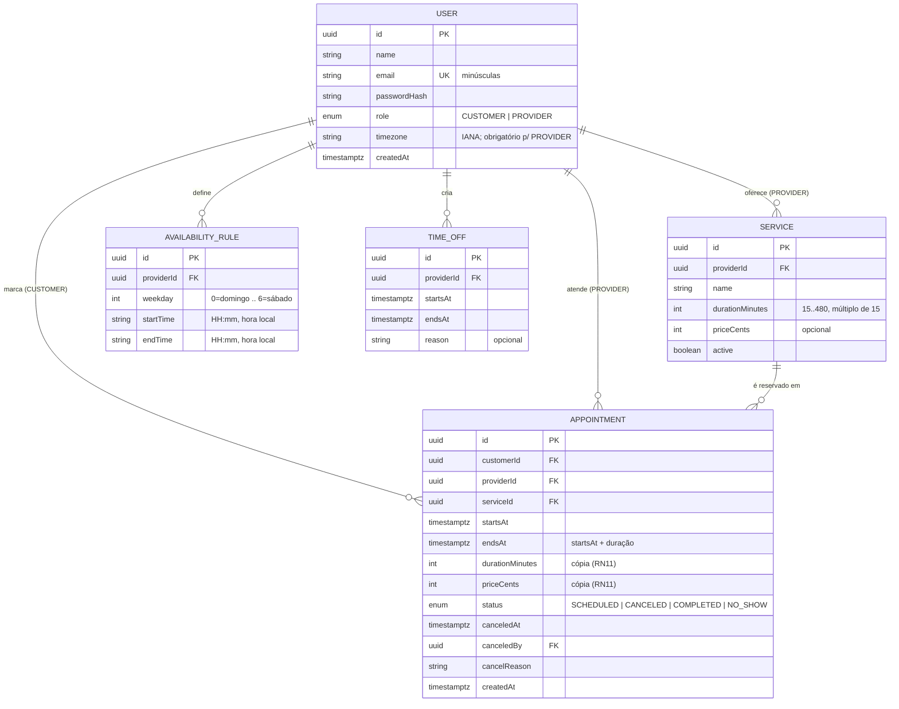

# Domínio: sistema de agendamento

Este documento define **o que o sistema é**: entidades, regras de negócio e contrato da API.
O [BACKLOG](BACKLOG.md) diz **o que construir e em que ordem**; aqui ficam as regras que ele usa (`RN01`, `RN02`...).

## Visão geral

Plataforma em que **profissionais** (barbeiro, dentista, professor particular...) publicam serviços e horários de atendimento, e **clientes** marcam, consultam e cancelam horários.

**Escopo do MVP (o que NÃO entra):** equipes ou várias salas por profissional, pagamento online, recorrência ("toda terça às 10h"), lista de espera. Cada profissional atende uma pessoa por vez.

## Glossário

| Termo                         | Significado                                                                 |
| ----------------------------- | --------------------------------------------------------------------------- |
| **Profissional** (`PROVIDER`) | Quem oferece serviços e atende.                                             |
| **Cliente** (`CUSTOMER`)      | Quem marca horários.                                                        |
| **Serviço**                   | O que o profissional oferece: nome, duração e preço (ex.: "Corte, 30 min"). |
| **Disponibilidade**           | Regra semanal de atendimento (ex.: segundas, 09:00–12:00 e 14:00–18:00).    |
| **Bloqueio**                  | Período em que o profissional não atende (férias, consulta médica).         |
| **Slot**                      | Horário livre **calculado** na hora da consulta. Não é salvo no banco.      |
| **Agendamento**               | Reserva de um slot por um cliente para um serviço.                          |
| **Grade**                     | Os horários de início possíveis, de 15 em 15 minutos.                       |

## Regras de negócio

| ID       | Regra                                                                                                                                                                                                                                                                                                                                                                                                                      |
| -------- | -------------------------------------------------------------------------------------------------------------------------------------------------------------------------------------------------------------------------------------------------------------------------------------------------------------------------------------------------------------------------------------------------------------------------- |
| **RN01** | **Fuso horário.** Todo profissional tem um fuso IANA (ex.: `America/Sao_Paulo`). A disponibilidade é escrita em **hora local do profissional** (`"09:00"`). Todo instante guardado no banco é **UTC**. A API recebe e devolve datas em ISO 8601 com `Z` ou offset (`2026-12-01T13:00:00Z`).                                                                                                                                |
| **RN02** | **Grade de 15 minutos.** Um horário de início só é válido se cair em minuto `00`, `15`, `30` ou `45` **no fuso do profissional**. A duração de um serviço vai de 15 a 480 minutos e é múltiplo de 15.                                                                                                                                                                                                                      |
| **RN03** | **Slot livre.** Um início `S` é um slot livre para um serviço de duração `D` se, ao mesmo tempo: (a) o intervalo `[S, S+D)` cabe **inteiro** dentro de um intervalo de disponibilidade do dia; (b) não sobrepõe nenhum agendamento `SCHEDULED` do profissional; (c) não sobrepõe nenhum bloqueio; (d) `S` é pelo menos **60 minutos** depois de agora (antecedência mínima); (e) `S` está dentro dos próximos **60 dias**. |
| **RN04** | **Sem overbooking.** Dois agendamentos `SCHEDULED` do mesmo profissional nunca se sobrepõem. Os intervalos são **semiabertos** `[início, fim)`: um agendamento que termina às 10:00 e outro que começa às 10:00 **não** conflitam. Sobreposição: `A.início < B.fim && B.início < A.fim`. O **banco** deve garantir isso, e não só o código.                                                                                |
| **RN05** | **Status.** `SCHEDULED` → `CANCELED`, `COMPLETED` ou `NO_SHOW`. Esses três são finais: nada sai deles.                                                                                                                                                                                                                                                                                                                     |
| **RN06** | **Cancelamento.** O cliente cancela até **24 h antes** do início. O profissional cancela a qualquer momento. Cancelar não apaga: guarda-se `canceledAt`, `canceledBy` e, se informado, o motivo. O horário volta a ficar livre.                                                                                                                                                                                            |
| **RN07** | **Remarcação.** Troca o horário do mesmo agendamento (mesmo serviço e profissional) com as mesmas validações de um novo agendamento. É **atômica**: se o novo horário falhar, o original continua intacto. O cliente respeita o prazo da RN06.                                                                                                                                                                             |
| **RN08** | **Autorização.** Cliente enxerga e altera só os **seus** agendamentos. Profissional enxerga e altera só a **sua** agenda e os **seus** serviços. Recurso de outra pessoa responde **404** (não 403), para não revelar o que existe.                                                                                                                                                                                        |
| **RN09** | **Serviço desativado** não aceita novos agendamentos, mas os já marcados continuam. Serviço com agendamentos **nunca é apagado**: só desativado (`active = false`).                                                                                                                                                                                                                                                        |
| **RN10** | **Bloqueio × agendamentos existentes.** Criar um bloqueio que sobreponha agendamentos `SCHEDULED` é recusado (409), listando os conflitantes. O profissional cancela esses agendamentos primeiro.                                                                                                                                                                                                                          |
| **RN11** | **Histórico imutável.** O agendamento guarda uma **cópia** da duração e do preço do serviço no momento da reserva. Editar o serviço depois não altera agendamentos passados.                                                                                                                                                                                                                                               |
| **RN12** | **Cliente em um lugar só** _(extra)_. Um cliente não pode ter dois agendamentos `SCHEDULED` que se sobreponham, mesmo com profissionais diferentes.                                                                                                                                                                                                                                                                        |

## Modelo de dados



**Índices que valem a pena:** `USER.email` (único), `APPOINTMENT(providerId, startsAt)`, `APPOINTMENT(customerId, startsAt)`.

## Contrato da API (rascunho)

Acesso: **público** (sem login), **login** (qualquer usuário), **CUSTOMER** ou **PROVIDER**.

| Método      | Rota                                              | Acesso                    | HU         |
| ----------- | ------------------------------------------------- | ------------------------- | ---------- |
| POST        | `/auth/register`                                  | público                   | HU01       |
| POST        | `/auth/login`                                     | público                   | HU02       |
| GET / PATCH | `/me`                                             | login                     | HU03       |
| POST        | `/services`                                       | PROVIDER                  | HU04       |
| GET         | `/services`                                       | PROVIDER                  | HU05       |
| PATCH       | `/services/:id`                                   | PROVIDER                  | HU05       |
| GET         | `/providers`                                      | público                   | HU06       |
| GET         | `/providers/:id/services`                         | público                   | HU06       |
| PUT / GET   | `/availability`                                   | PROVIDER                  | HU07       |
| POST / GET  | `/time-offs`                                      | PROVIDER                  | HU08       |
| DELETE      | `/time-offs/:id`                                  | PROVIDER                  | HU08       |
| GET         | `/providers/:id/slots?serviceId=&date=YYYY-MM-DD` | público                   | HU09       |
| POST        | `/appointments`                                   | CUSTOMER                  | HU10       |
| GET         | `/appointments`                                   | login (filtra pelo papel) | HU11, HU13 |
| GET         | `/appointments/:id`                               | login                     | HU11       |
| POST        | `/appointments/:id/cancel`                        | login                     | HU12       |
| POST        | `/appointments/:id/complete`                      | PROVIDER                  | HU14       |
| POST        | `/appointments/:id/no-show`                       | PROVIDER                  | HU14       |
| POST        | `/appointments/:id/reschedule`                    | login                     | HU15       |

### Padrões de resposta

**Erros** sempre no mesmo formato, para o front tratar de um jeito só:

```json
{
  "error": {
    "code": "SLOT_UNAVAILABLE",
    "message": "Esse horário acabou de ser reservado.",
    "details": null
  }
}
```

| Status | Quando                                                  | Exemplos de `code`                                                       |
| ------ | ------------------------------------------------------- | ------------------------------------------------------------------------ |
| 400    | Entrada inválida (formato, tipo, intervalo)             | `VALIDATION_ERROR` (com `details` por campo)                             |
| 401    | Sem token, token inválido ou expirado                   | `UNAUTHENTICATED`                                                        |
| 403    | Logado, mas o papel não pode usar a rota                | `FORBIDDEN`                                                              |
| 404    | Não existe **ou** é de outra pessoa (RN08)              | `NOT_FOUND`                                                              |
| 409    | Conflito de estado ou de horário                        | `SLOT_UNAVAILABLE`, `EMAIL_TAKEN`, `INVALID_STATUS`, `TIME_OFF_CONFLICT` |
| 422    | Entrada bem formada, mas que viola uma regra de negócio | `INVALID_SLOT`, `CANCELLATION_WINDOW_PASSED`, `SERVICE_INACTIVE`         |

**Listas** paginadas: `?page=1&pageSize=20` → `{ "items": [...], "page": 1, "pageSize": 20, "total": 134 }`.

## Estrutura de pastas sugerida

```
src/
  http/          # rotas, controllers, middlewares (auth, erros, validação)
  domain/        # regras PURAS, sem banco nem HTTP: slots.ts, cancelamento.ts, status.ts
  services/      # casos de uso: orquestram domínio + banco
  repositories/  # acesso ao banco (Prisma)
  config/        # variáveis de ambiente validadas
tests/
  unit/          # domain/ (rápidos, sem banco)
  integration/   # rotas com banco de teste
prisma/
```

A parte mais importante é a **pasta `domain/`**: a função que calcula slots recebe dados e devolve dados, sem tocar em banco nem em relógio (a hora atual entra como parâmetro). Assim dá para testar com dezenas de casos em milissegundos.
